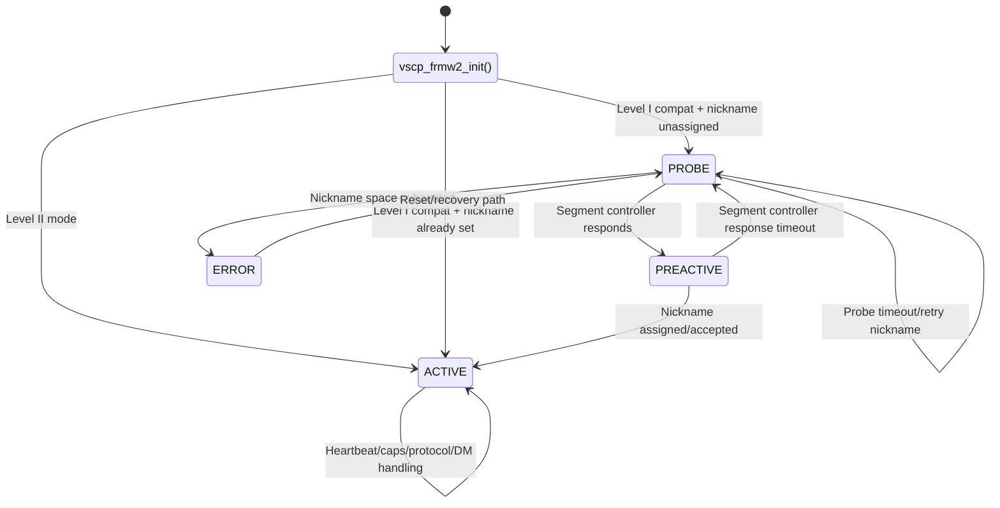
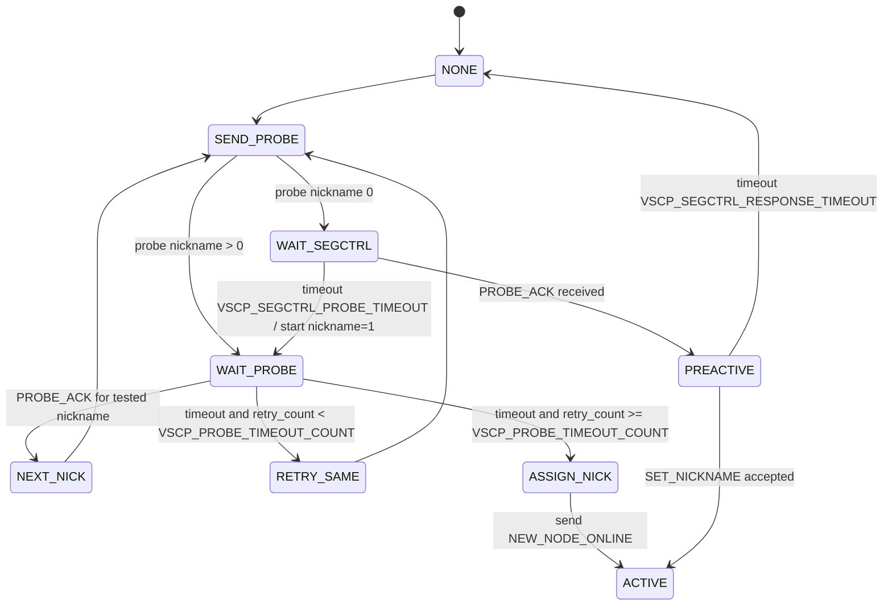

# vscp-firmware-level2

Last updated: 2026-11-20

This document describes the VSCP Level II firmware framework implemented by:

- `src/vscp-firmware-level2.h`
- `src/vscp-firmware-level2.c`

The module provides protocol handling, register abstraction, node state management, and decision-matrix execution for VSCP Level II nodes (and Level I compatibility paths where configured).

---

## Purpose

`vscp_frmw2_work()` is the main periodic protocol worker.

At runtime, the framework:

1. Handles node startup and state transitions.
2. Performs nickname discovery/wait logic for Level I compatibility mode.
3. Processes incoming protocol events.
4. Maintains standard register behavior.
5. Runs decision-matrix filtering and actions.
6. Sends periodic heartbeat/capabilities events when configured.

---

## Include and Dependencies

```c
#include <vscp-firmware-level2.h>
```

Primary dependencies:

- `vscp.h`
- `vscp-class.h`
- `vscp-type.h`
- `vscp-firmware-helper.h`
- `vscp-projdefs.h`

---

## Version and Constants

Framework version constants:

- `FRMW2_MAJOR_VERSION`
- `FRMW2_MINOR_VERSION`

Selected timing and probe constants:

- `VSCP_PROBE_TIMEOUT`
- `VSCP_PROBE_TIMEOUT_COUNT`
- `VSCP_SEGCTRL_PROBE_TIMEOUT`
- `VSCP_SEGCTRL_RESPONSE_TIMEOUT`

State constants:

- `FRMW2_STATE_NONE`
- `FRMW2_STATE_PROBE`
- `FRMW2_STATE_PREACTIVE`
- `FRMW2_STATE_ACTIVE`
- `FRMW2_STATE_ERROR`

Substate constants:

- `FRMW2_SUBSTATE_NONE`
- `FRMW2_SUBSTATE_SEGCTRL_PROBE_WAITING`
- `FRMW2_SUBSTATE_PROBE_WAITING`

---

## Core Configuration Structure

`vscp_frmw2_firmware_context_t` is the central runtime and configuration container.
(`vscp_frmw2_firmware_config_t` is a typedef alias provided for backward compatibility.)

Major groups inside the structure:

- Runtime state and timers (`state`, `substate`, `timer`)
- Level (`level`: `VSCP_LEVEL1` or `VSCP_LEVEL2`)
- Node identity (`nickname`, `guid`, `zone`, `subzone`, `index`)
- Probe/discovery behavior (`probe_nickname`, `probe_timeout`, `probe_timeout_count`)
- Optional behavior switches (`bEnableErrorReporting`, `bEnableLogging`, `bHighEndServerResponse`, `bEnableWriteProtectedLocations`, `bUse16BitNickname`, `bInterestedInAllEvents`, `bDmLevel1Rows`)
- Event scheduling (`interval_heartbeat`, `interval_caps`, in milliseconds, 0 = off)
- Decision matrix storage (`pDm`, `nDmRows`, `sizeDmRow`, `regOffsetDm`, `pageDm`)
- Standard registers and persistent fields (`userId`, `manufacturerId`, `manufacturerSubId`, `mdfurl`, `deviceName`, firmware versions, `standard_device_family`/`_type`, ...)
- `ops` — pointer to a `vscp_frmw2_ops_t` operations table (must be set before calling `vscp_frmw2_init()`)
- `puserdata` — free for the application (for example its transport context)

`zone` and `subzone` are what the decision matrix compares with when a row asks for a zone/subzone match. If they are user registers on your device, update the context when they are written.

The context pointer `pctx` is passed as the first argument to every public function and to every callback.

---

## Public Framework API

### Initialization and Main Work

- `vscp_frmw2_init`
- `vscp_frmw2_work`
- `vscp_frmw2_setup_event`

### Nickname and Protocol Handling

- `vscp_frmw2_send_probe`
- `vscp_frmw2_nickname_discovery`
- `vscp_frmw2_nickname_wait`
- `vscp_frmw2_handle_protocol_event`

### Register and Page Operations

- `vscp_frmw2_read_reg`
- `vscp_frmw2_write_reg`
- `vscp_frmw2_page_read`
- `vscp_frmw2_page_write`
- `vscp_frmw2_vscp2_register_read`
- `vscp_frmw2_vscp2_register_write`
- `vscp_frmw2_extended_page_read`
- `vscp_frmw2_extended_page_write`

### Periodic and Discovery Events

- `vscp_frmw2_send_heartbeat`
- `vscp_frmw2_send_caps`
- `vscp_frmw2_send_high_end_server_probe`
- `vscp_frmw2_whois_response`

### Decision Matrix

- `vscp_frmw2_feed_level1_dm`
- `vscp_frmw2_feed_level2_dm`
- `vscp_frmw2_feed_dm`
- `vscp_frmw2_report_dmatrix`

---

## Callback Contract (Implemented by Application/Port)

All platform-specific behavior is provided through a `vscp_frmw2_ops_t` operations table.
Populate the struct and assign it to `ctx.ops` before calling `vscp_frmw2_init()`.
Every callback receives `pctx` as its first argument.

Mandatory (`vscp_frmw2_init()` returns `VSCP_ERROR_INIT_MISSING` if one is NULL): `get_milliseconds`, `get_timestamp`, `send_event`, `set_event_time`, `read_reg`, `write_reg`, `stdreg_change`. Set the others to NULL if they are not used.

Time and lifecycle callbacks:

- `get_milliseconds`
- `get_timestamp`
- `enter_bootloader`
- `restore_defaults`
- `reset`
- `feed_watchdog`

Transport and event callbacks:

- `send_event` — the event belongs to the framework (it is often on its stack). Copy it (`vscp_fwhlp_mkEventCopy()`) if it is queued; do not free it
- `set_event_time`
- `report_events_of_interest`
- `segment_ctrl_heartbeat`

Decision matrix callback:

- `dm_action(pctx, pev, action, pparam)` — called for each enabled row that matches the event. `pparam` points at the action parameter in the row (one byte for Level I rows, the parameter area for Level II rows)

Register and network callbacks:

- `read_reg(pctx, page, reg, pval)` / `write_reg(pctx, page, reg, val)` — the user registers (below the standard registers). The decision matrix registers are user registers too: map `regOffsetDm` and up to `pDm`
- `stdreg_change(pctx, stdreg)` — a standard register that should be saved (user id, nickname, ...) was written. The new value is in the context; save it
- `get_ip_addr`

---

## Runtime State Machine Overview

Typical flow:

1. `vscp_frmw2_init(&ctx)` sets defaults and initial state.
2. Node enters active state immediately in Level II mode.
3. In Level I compatibility mode, framework may run probe/nickname phases first.
4. `vscp_frmw2_work(&ctx, pev)` is called periodically:
   - with `pev != NULL` for every event received from the transport. It handles protocol events (register read/write, who is there, ...) and runs the event through the decision matrix. The caller still owns the event afterwards and frees it
   - with `pev == NULL` for periodic/state processing (heartbeat, capabilities)
5. Framework updates heartbeats/caps/protocol responses and applies decision matrix actions.

## Level II Startup/Runtime Diagram



## Nickname Discovery Timing Diagram



---

## Register Model Notes

The framework supports standard register handling and app-defined register callbacks.

Key points:

- `vscp_frmw2_read_reg()` / `vscp_frmw2_write_reg()` operate across standard and user register spaces.
- Page-based operations are provided for protocol page reads/writes.
- Extended page read/write supports larger access patterns.
- `ops->stdreg_change` is called to persist changes to standard register-backed data.

---

## Decision Matrix Notes

Decision matrix support is configurable through fields in `vscp_frmw2_firmware_context_t`:

- `pDm` — row storage (NULL = no decision matrix)
- `nDmRows` — number of rows
- `sizeDmRow` — bytes per row
- `regOffsetDm` — first register of the matrix, reported by `vscp_frmw2_report_dmatrix()` (the register mapping itself is done in `read_reg`/`write_reg`)
- `pageDm` — register page of the matrix
- `bDmLevel1Rows` — use Level I rows on a Level II device

`vscp_frmw2_feed_dm()` (called from `vscp_frmw2_work()`) uses Level I rows when `level == VSCP_LEVEL1` or `bDmLevel1Rows` is set, else Level II rows, and calls `ops->dm_action` for every enabled row that matches.

**Level I row** (8 bytes, `VSCP_LEVEL1_DM_POS_*`):

| Byte | |
| --- | --- |
| 0 | Origin (nickname, compared with GUID byte 15 when flag 0x40 is set) |
| 1 | Flags: 0x80 enabled, 0x40 check origin, 0x20 hardcoded, 0x10 match zone (data byte 1), 0x08 match subzone (data byte 2), 0x02/0x01 bit 8 of class mask/filter |
| 2, 3 | Class mask, class filter |
| 4, 5 | Type mask, type filter |
| 6 | Action |
| 7 | Action parameter |

An event matches when `(class & mask) == (filter & mask)` for both class and type. Zone/subzone 255 in the event matches any zone.

**Level II row** (`VSCP_LEVEL2_DM_POS_*`): flags (32 bits, MSB first) at 0, class (16 bits) at 4, type (16 bits) at 6, origin GUID at 8, action (16 bits) at 24 and parameters from 26. Flags: `VSCP_LEVEL2_DM_FLAG_ENABLED`, `_CHECK_OADDR` (GUID must match), `_END_MARK`, `_CHECK_INDEX`/`_CHECK_ZONE`/`_CHECK_SUBZONE` (data bytes 0/1/2). The class and type must match exactly.

---

## Event Data Model

The framework uses `vscpEvent` (`vscp_event_t`, see `vscp.h`) throughout — a pointer-based event struct: `head`, `obid`, the time block, `vscp_class`, `vscp_type`, `GUID[16]`, `sizeData` and `pdata` (pointer to the data, max 512 bytes).

The time block is either date/time (`year`, `month`, `day`, `hour`, `minute`, `second`) plus a relative `timestamp` in microseconds, or — when the header has `VSCP_HEADER16_FRAME_VERSION_UNIX_NS` and `year`/`month` are 0xffff/0xff — a 64-bit Unix time in nanoseconds, `timestamp_ns`, which shares memory with `day` ... `timestamp` (a union).

To make an event from the node use `vscp_frmw2_setup_event(pctx, pev, sizeData)`. It sets the header (normal priority, Unix ns time), the GUID of the node and the time (`ops->set_event_time`), and allocates a zeroed data buffer of `sizeData` bytes in `pev->pdata`, which the caller frees:

```c
vscp_event_t ev;
memset(&ev, 0, sizeof(ev));
if (VSCP_ERROR_SUCCESS == vscp_frmw2_setup_event(pctx, &ev, 3)) {
  ev.vscp_class = VSCP_CLASS1_INFORMATION;
  ev.vscp_type  = VSCP_TYPE_INFORMATION_ON;
  ev.pdata[0]   = 0;             // index
  ev.pdata[1]   = pctx->zone;
  ev.pdata[2]   = pctx->subzone;
  pctx->ops->send_event(pctx, &ev);
  free(ev.pdata);
}
```

For incoming events passed to `vscp_frmw2_work()`, `vscp_frmw2_handle_protocol_event()`, or
the DM feed functions: the framework validates `pdata` at each entry point — if `sizeData > 0`
and `pdata == NULL` the call returns `VSCP_ERROR_INVALID_POINTER`.

---

## Minimal Integration Pattern
```c
// Define operations table
static const vscp_frmw2_ops_t my_ops = {
  .get_milliseconds = my_get_ms,
  .get_timestamp    = my_get_ts,
  .send_event       = my_send_event,    // vscpEvent* (pointer-based)
  .set_event_time   = my_set_event_time,
  .read_reg         = my_read_reg,
  .write_reg        = my_write_reg,
  .stdreg_change    = my_stdreg_change,
  // ... other callbacks
};

vscp_frmw2_firmware_context_t ctx;
memset(&ctx, 0, sizeof(ctx));

ctx.level = VSCP_LEVEL2;
ctx.ops   = &my_ops;

int rv = vscp_frmw2_init(&ctx);
if (VSCP_ERROR_SUCCESS == rv) {
  for (;;) {
    // If no incoming event:
    vscp_frmw2_work(&ctx, NULL);

    // If an incoming event is available (for example parsed from a frame,
    // JSON or the link protocol into an event from vscp_fwhlp_newEvent()):
    // vscp_frmw2_work(&ctx, pev);
    // vscp_fwhlp_deleteEvent(&pev);   // still owned by the caller
  }
}
```

---

## Common Integration Pitfalls

- Not calling `vscp_frmw2_work()` frequently enough for timers/probe/heartbeat handling.
- Missing callback implementations (especially send-event, register read/write, and time callbacks).
- Inconsistent register persistence handling after standard-register changes.
- Misconfigured decision matrix row size or storage pointer.
- Mixing Level I/Level II assumptions without setting `level` and transport behavior accordingly.
- Freeing the event in `send_event` (it belongs to the framework), or not freeing events passed to `vscp_frmw2_work()` (they still belong to the caller).
- Forgetting `crcInit()` (`vscp-crc.h`) before frames are made or checked: the frame CRCs are then 0 and received CRCs are not checked.

## Examples

Complete Level II nodes (the Blinky demo):

- [vscp-demo-esp32-wifi-blinky](https://github.com/grodansparadis/vscp-demo-esp32-wifi-blinky) — ESP32, link protocol, UDP, multicast, MQTT. See `main/blinky.c`
- [vscp-demo-link-stm32f401-wiz-ip20-blinky](https://github.com/grodansparadis/vscp-demo-link-stm32f401-wiz-ip20-blinky) — STM32F401 with a WIZ-IP20 module. See `firmware/callbacks-frm2.c`

---

## Related Files

- `src/vscp-firmware-level2.h`
- `src/vscp-firmware-level2.c`
- `src/vscp-firmware-helper.h`
- `src/vscp-firmware.h`
- `docs/README.md`
